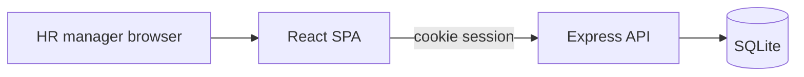

# Design notes

These notes record the decisions behind ACME Salary Management. The one-page requirements live in [requirements.md](requirements.md).

## Architecture

The HR manager uses a React app. The app talks to one Express API. The API stores data in SQLite through Prisma. In production the same Node process serves the built UI and the API. There is no separate database server.

Layout:

- `server/` — Express, Zod, domain functions, Prisma access, tests.
- `web/` — React, Vite, React Router, Mantine.
- `prisma/schema.prisma` — schema. The seed runner lives under `server/src/seed/`.

A request is authenticated from the session cookie, validated with Zod, then handled by a small route module. Money math sits in pure functions. Routes do not add currencies.

## Data model

- `User` — the single HR account. Password stored as a scrypt hash.
- `Session` — random token, only the SHA-256 hash is stored, with an expiry.
- `FxRate` — currency code, USD value of one unit, and the snapshot date.
- `Employee` — current salary attributes. Indexes on country, department, job level, and employee number.
- `SalaryRevision` — appended only when `annualSalary` changes. The current salary on the employee is what the directory shows.

Country and currency are a fixed pair (United States/USD, United Kingdom/GBP, Germany/EUR, India/INR, Singapore/SGD, Brazil/BRL, Canada/CAD, Australia/AUD). An edit cannot move an employee to another currency.

Insights count active employees only. Inactive people remain in the directory so HR can still find them. Payroll questions are about who the org pays now.

## Money

Stored amounts are decimals, serialized as strings in JSON (`"100000.00"`). JavaScript `number` is not used for stored money.

Local payroll is a SQL `SUM` grouped by currency. Those totals are never added across currencies.

USD comparison converts each active salary with the snapshot rate, rounds half-up to cents, then sums the cents. Median by level uses those same cent values. The home screen labels USD as a comparison and shows the rate date (15 January 2026).

The domain function that adds two amounts throws if the currencies differ.

## API

| Method | Path | Purpose |
| --- | --- | --- |
| POST | `/api/login` | Create a session cookie |
| POST | `/api/logout` | Revoke the session |
| GET | `/api/me` | Current HR user |
| GET | `/api/employees` | Paged search |
| GET | `/api/employees/:id` | Person plus recent revisions |
| PATCH | `/api/employees/:id` | Edit salary and job attributes |
| GET | `/api/insights` | The home-screen questions |
| GET | `/api/insights/country/:country` | Highest and lowest paid in that country |
| GET | `/api/meta` | Filter choices and the rate date |
| GET | `/api/export/employees.csv` | Current sheet |

List queries take `q`, `country`, `department`, `jobLevel`, `status`, `page`, and `pageSize` (maximum 50). Errors use `{ title, detail, errors? }`. Routes other than login return 401 when the cookie is missing or expired.

## Tradeoffs

- **SQLite instead of PostgreSQL.** One HR user and 10,000 rows fit in a single file. Tests and the production container both run without a database service. Prisma can point at Postgres later by changing the provider.
- **Revision log instead of effective dating.** HR needs to see what changed. They do not need future-dated pay or a workflow engine.
- **Fixed questions instead of a chat interface.** The figures are testable. A model that can invent a payroll total is the wrong tool for this screen.
- **Static FX snapshot instead of a live feed.** Tests stay deterministic. The date is visible so the comparison is not mistaken for a payment amount.
- **TypeScript median instead of a SQL percentile.** The API loads salary, currency, level, department, and country for active employees (10,000 short rows) and computes the median in a tested function.
- **Single HR account instead of a role model.** The brief names one persona. A role matrix would have nothing to distinguish.
- **CSV export, no in-app importer.** The required load of 10,000 people is the seed script. Export gives HR a sheet back. Row-by-row edit is the maintenance path.

## Performance

10,000 employees is a small SQLite database if the UI stays paged and the aggregates stay narrow.

- Indexes on the filter columns.
- The directory query selects a page of 50, not the full table.
- Insights select only the columns the math needs.
- CSV export streams rows.
- The seed inserts in batches inside a transaction.
- One Node process. No cache and no background worker.

## Testing

Unit tests cover mixed-currency addition, USD conversion, median, the country/currency catalog, and the deterministic employee generator. They do not touch the network or insert 10,000 rows.

API tests use a temporary SQLite file and a hand-computed fixture: login required, page size honored, a salary edit writes one revision and moves the payroll total, and insight figures match literals calculated from that fixture.

## How AI was used

Cursor’s agent implemented this repository from a written plan. The plan was constrained before coding: one persona, base salary only, SQLite, tested money math, and no payroll or approval workflow.

Instructions given to the agent:

- Write the one-page requirements and these notes before application code.
- Keep money in decimals. Refuse to add different currencies. Label USD as a comparison.
- Put tests in the same slice as the behavior they lock.
- Seed 10,000 employees from a pure, seeded generator.
- Commit in slices that match the plan: docs, schema and seed, domain tests, API, login, UI, then export and deployment.

The agent was not asked to invent extra personas, bands, or a chat feature. Review focus is the schema, the session check, and the insights math.

## Demo credentials

Local and seeded deployments sign in as `hr@acme.test`. The password comes from `HR_PASSWORD` and defaults to `acme-hr-demo` so a reviewer can open the app. Change that password before any real employee data is loaded.
